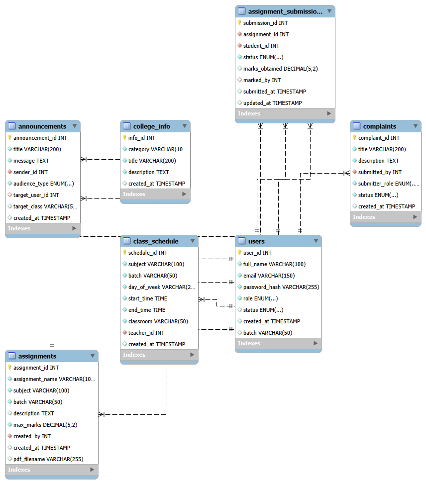
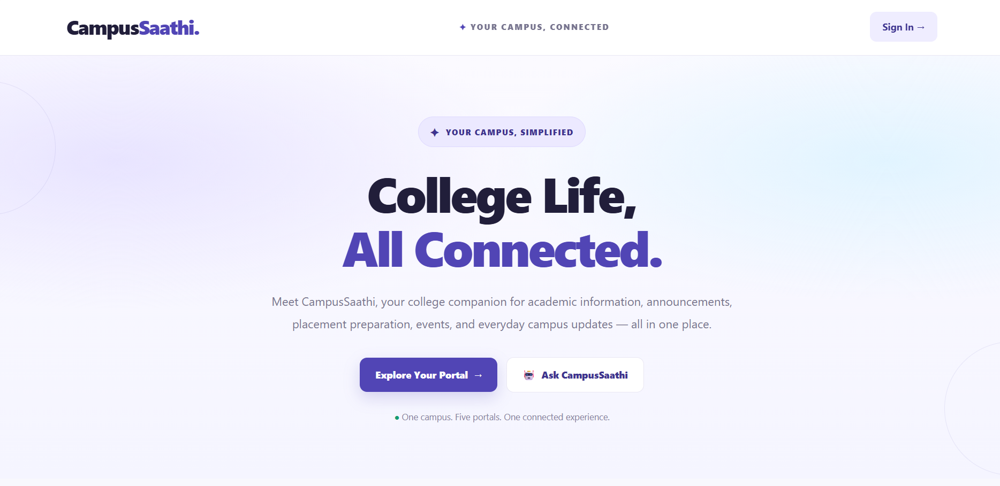

# 🎓 CampusSaathi
### Your Campus. Connected. Simplified.

**CampusSaathi** is a Java-based academic web application project designed to organize campus-related academic activities and simplify assignment workflows for teachers and students.

This repository contains the application's source code, project documentation, weekly development progress, and supporting materials for the academic project.

---

## 📌 Table of Contents

- [Project Overview](#-project-overview)
- [Objectives](#-objectives)
- [Technology Stack](#-technology-stack)
- [Project Modules](#-project-modules)
- [Project Structure](#-project-structure)
- [Team Responsibilities](#-team-responsibilities)
- [Weekly Development Progress](#-weekly-development-progress)
- [Documentation and Deliverables](#-documentation-and-deliverables)
- [Testing Strategy](#-testing-strategy)
- [Setup and Execution](#-setup-and-execution)
- [Current Project Status](#-current-project-status)
- [Team Information](#-team-information)

---

## 📖 Project Overview

CampusSaathi is an academic software development project intended to provide a common platform for campus-related academic workflows.

The project focuses on teacher and student interactions, assignment management, PDF document handling, and related academic information. Development is organized into weekly milestones covering project planning, environment setup, database design, implementation, integration, testing, and documentation.

## 🎯 Objectives

- Develop a structured academic web application using Java technologies.
- Support teacher and student workflows.
- Organize assignment creation and student access to assignments.
- Support assignment document upload and download.
- Apply authentication, session management, and role-based access controls.
- Use MySQL for relational data storage.
- Maintain clear technical documentation and weekly progress records.
- Organize source code and project deliverables through GitHub.

---

## 🛠️ Technology Stack

| Technology | Purpose |
|---|---|
| Java 21 | Application logic |
| Jakarta Servlets | Server-side request handling |
| JSP | Dynamic web pages, where used |
| JDBC | Database connectivity |
| MySQL | Relational database |
| Apache Tomcat 11 | Web application server |
| Eclipse IDE | Development environment |
| Git | Version control |
| GitHub | Source code hosting and project documentation |

---

## ✨ Project Modules

The following modules describe the intended application areas. Their implementation status will be updated against the actual source code and verified tests.

### 1. Authentication and Session Management
- Teacher and student login workflows.
- Session handling.
- Role-based access checks.

### 2. Teacher Assignment Management
- Assignment creation.
- Assignment details and related data handling.
- PDF attachment upload workflow.

### 3. Student Assignment Portal
- Student assignment listing.
- Batch-based filtering, where configured.
- Assignment document viewing and downloading.

### 4. PDF Upload and Storage
- PDF file handling.
- UUID-based filenames, as reported in the development progress.
- File-size validation and storage configuration.

### 5. PDF Access Control
- Role checks for assignment document access.
- Teacher/student access restrictions, subject to continued verification.

### 6. Marks-Related Functionality
- Integration of existing marks information into the student portal.
- Association of assignment status with marks-related information.

---

## 📂 Project Structure

The repository currently contains the Java web application source and Eclipse project files.

```text
CampusSaathi/
├── src/
│   └── main/
│       ├── java/
│       │   └── com/
│       │       └── campussaathi/
│       │           └── controller/
│       └── webapp/
├── .classpath
├── .gitignore
├── .project
└── README.md
```

Additional documentation directories and supporting files will be added as the corresponding materials are prepared and verified.

---

## 👥 Team Responsibilities

The team has divided responsibilities across project planning, backend development, database design, authentication, and documentation.

| Team Member | Reported Responsibility |
|---|---|
| Manvi Asawa | Backend development, teacher assignment functionality, README and repository organization |
| Mausam | Database schema design and updates |
| Nikita | Authentication, session handling, student portal and PDF access control |
| Nikita Rathore | Student assignment view |
| Kusum | Marks-related integration, SRS, abstract and report preparation |

*Note: Responsibilities are based on the team's current progress notes and may overlap. Final ownership will be confirmed with the team.*

---

## 📅 Weekly Development Progress

This section tracks the project across 12 academic weeks. Statuses reflect the progress information currently available and will be updated as deliverables are verified.

### Progress Summary

| Week | Objective | Status |
|---|---|---|
| 1 | Project scope and team responsibilities | Completed |
| 2 | Development environment setup | Completed |
| 3 | Database schema design | Completed |
| 4 | Authentication module | In Progress |
| 5 | Teacher assignment creation | In Progress |
| 6 | PDF upload and storage | Completed |
| 7 | Student assignment portal | In Progress |
| 8 | PDF access control | In Progress |
| 9 | Marks-related functionality | In Progress |
| 10 | Integration testing | In Progress |
| 11 | Documentation and presentation preparation | In Progress |
| 12 | Final demonstration and GitHub organization | Pending |

### Week 1 — Project Scope and Team Responsibilities

## Week 1: Project Guide, Team Formation & Project Abstract

### 1. Project Guide

- **Guide Name:** Er. Ram Babu Buri

### 2. Department & Academic Specification

- **Department:** Artificial Intelligence and Data Science (AI & DS)
- **Academic Context:** RTU, 5th Semester
- **Project Title:** CampusSaathi — Academic Assignment Management System
- **Project Tagline:** Your Campus. Connected. Simplified.

### 3. Project Team & Responsibilities

| Team Member | Role | Module / Responsibility | Enrollment / Roll No. | Email |
|---|---|---|---|---|
| Manvi Asawa | Backend Development | Teacher assignment management, backend development, README and repository organization | Pending | Pending |
| Mausam | Database Developer | Database design and schema | Pending | Pending |
| Nikita | Authentication & Portal Developer | Authentication, session handling, student portal and PDF access | Pending | Pending |
| Nikita Rathore | Student Portal Developer | Student assignment viewing | Pending | Pending |
| Kusum | Documentation & Integration | Marks integration, SRS, abstract and project report | Pending | Pending |

### 4. Project Abstract

CampusSaathi — Academic Assignment Management System is a centralized Java-based web application designed to streamline assignment handling for college students and teachers. It provides a structured, accessible platform for managing assignment information and associated PDF question papers, replacing fragmented communication channels with a unified workflow.

The application uses Java 21, Jakarta Servlets, JSP, JDBC, Apache Tomcat 11, MySQL, HTML and CSS. Its core features include role-based authentication, session tracking, teacher-side assignment creation, optional PDF uploads, batch-based student assignment retrieval and servlet-based authorization for secure document access.

The project follows the Model-View-Controller (MVC) design pattern and integrates MySQL for persistent storage. It also brings together assignment management, document access and marks-related functionality in a centralized academic platform.

The project is developed under the academic framework of Rajasthan Technical University (RTU) and serves as an academic prototype demonstrating Java web technologies and software development practices.

### 5. Week 1 Deliverables

- Project title and scope identification
- Project guide and department details
- Initial team responsibility allocation
- Project abstract

### 6. Week 1 Status

**Status:** Partially documented — project and team details recorded; enrollment numbers and email addresses are yet to be added.

### 7. Supporting Evidence

- Project abstract document: `ABSTRACTCAMPUSSAATHI.docx`
- Team responsibility chart: Add the actual file or image link when available.
  📄 **Full Abstract:** [View / Download CampusSaathi Abstract](ABSTRACTCAMPUSSAATHI.docx)

### Week 2 — Development Environment Setup

## Week 2: User Roles, SRS & System Architecture

### 1. Software Requirements Specification (SRS)

The Software Requirements Specification (SRS) defines the purpose, scope, user roles, functional requirements, non-functional requirements, interfaces, and analysis models of CampusSaathi.

📄 **SRS Document:** [View / Download CampusSaathi SRS](SRSCAMPUSSATHI.pdf)

### 2. Architecture & Core Modules

CampusSaathi is an academic assignment management web application developed using Java web technologies. The reported technology stack includes:

- **Backend:** Java 21, Jakarta Servlets
- **Frontend:** JSP, HTML, CSS
- **Database:** MySQL with JDBC
- **Server:** Apache Tomcat 11
- **Development Environment:** Eclipse IDE
- **Architecture:** MVC-style separation of application responsibilities

The current system design focuses on authentication, assignment management, PDF handling, student assignment viewing, and marks-related functionality.

### 3. User Roles

| User Role | Responsibility |
|---|---|
| Admin | Generates or provides login credentials for Teacher, Student, HOD, and Club Lead |
| Teacher | Creates assignments and manages assignment-related marks functionality |
| Student | Views relevant assignments, PDFs, and marks-related information |
| HOD | View-oriented access; exact permissions to be verified |
| Club Lead | View-oriented access; exact permissions to be verified |

### 4. Functional Modules

- Role-based login and session handling
- Admin-managed user credentials
- Teacher assignment creation
- Optional PDF upload for assignments
- Batch-wise assignment display for students
- Controlled PDF viewing and downloading
- Marks-related functionality
- View-oriented access for HOD and Club Lead

The final functionality will be documented against the actual implementation.

### 5. Relational Database Strategy

MySQL is used as the reported relational database, with JDBC for database connectivity. Assignment information and associated PDF metadata are intended to be stored and retrieved through the application's database operations.

The final table structure, relationships, constraints, and marks-related database details will be documented after verification of the actual schema.

### 6. Non-Functional Requirements

- **Security:** Apply authentication and server-side authorization checks.
- **Data Integrity:** Maintain correct associations between assignment records and PDF metadata.
- **Reliability:** Handle invalid inputs, database errors, and unavailable or unauthorized files appropriately.
- **Maintainability:** Keep request handling, views, and database operations reasonably separated.
- **Usability:** Provide role-relevant pages and understandable validation messages.
- **File Handling:** Validate uploads and protect access to stored assignment PDFs.

### 7. Week 2 Deliverables

| Deliverable | Status |
|---|---|
| Software Requirements Specification (SRS) | Document prepared; verify against implementation |
| Technology stack identification | Documented |
| User roles and responsibilities | Initial requirements documented |
| System architecture description | Initial design documented |
| Functional and non-functional requirements | Documented; implementation verification pending |


**Week 2 Status:** Requirements documentation and initial system design prepared. Detailed implementation and verification will continue in subsequent weeks.

### Week 3 — Database Schema Design

## Week 3 — System Design and UML Diagrams

### 1. Objective

The objective of Week 3 was to design and document the CampusSaathi system using diagrams that explain its functionality, architecture, components, deployment, and interactions.

### 2. Assignment Management Diagram

This diagram illustrates the assignment management workflow in CampusSaathi.


### 3. Student Assignment Diagram

This diagram represents the student assignment-related workflow.


### 4. UML Class Diagram

The Class Diagram represents the classes and their relationships in the system.


### 5. UML Component Diagram

The Component Diagram illustrates the major software components and their organization.


### 6. UML Deployment Diagram

The Deployment Diagram represents the deployment structure of the system.


### 7. UML Sequence Diagram

The Sequence Diagram illustrates the sequence of interactions between system components during a workflow.


### 8. Use Case Diagram

The Use Case Diagram represents the actors and their interactions with CampusSaathi.


### 9. Week 3 Deliverables

- Assignment Management Diagram
- Student Assignment Diagram
- UML Class Diagram
- UML Component Diagram
- UML Deployment Diagram
- UML Sequence Diagram
- Use Case Diagram

### 10. Status

The seven diagrams are documented as part of the CampusSaathi system design documentation.
### Week 4 — Authentication Module
## Week 4 — Database Design, UI Mock-ups & Authentication Module

### 1. Objective

The objective of Week 4 is to design and document the CampusSaathi database, organize the user interface mock-ups, and work on the authentication module, including login, session handling, and role-based access control.

### 2. Database Design

The project uses MySQL as its database management system. The database, `campussaathi_db`, contains seven tables to support user management, assignment distribution, submissions, announcements, class scheduling, college information, and complaints.

**Database tables:**

| Table | Purpose |
|---|---|
| `users` | Stores user details, roles, account status, and batch information. |
| `assignments` | Stores assignment details, subjects, batches, descriptions, marks, and PDF filenames. |
| `assignment_submissions` | Tracks student submissions, submission status, and marks. |
| `announcements` | Stores announcements and their intended audiences. |
| `class_schedule` | Stores class schedules, timings, classrooms, and teacher references. |
| `college_info` | Stores general college information and notices. |
| `complaints` | Stores complaints, submitter details, and complaint status. |

### 3. Database Relationships and Integrity

The database uses primary keys and foreign keys to connect related records and maintain data integrity.

- Users can create assignments and be referenced as teachers, students, or announcement senders.
- Assignment submissions connect assignments with students.
- Submission records can reference the user who marked the work.
- Announcements can reference their sender and, where applicable, a target user.
- Class schedules can reference the assigned teacher.
- Complaints reference the user who submitted them.
- Unique constraints help prevent duplicate user emails and duplicate assignment or student-submission combinations.

### 4. Database Schema

The database structure has been exported to an SQL file.

**Schema file:** [`CampusSaathi_Schema.sql`](CampusSaathi_Schema.sql)

The file documents the database structure and table definitions. It should be reviewed before being executed against any existing database.

### 5. Entity–Relationship (ER) Diagram

The ER diagram represents the database tables and their relationships.



**Diagram file:** [`CampusSaathi_ER_Diagram.png`](CampusSaathi_ER_Diagram.png)

Detailed database documentation is available in [`docs/docs/database/README.md`](docs/docs/database/README.md).

### 6. UI Mock-ups and Screenshots

Eight UI screenshots have been uploaded to the repository to document the planned or developed interface views for different user roles.

#### Main Dashboard



#### Dashboard Variation A

.png)

#### Dashboard Variation B

.png)

#### Administration Portal


#### HOD Portal


#### Teacher Portal


#### Student Portal


#### Club Leader Portal


All eight screenshots are documented in [`docs/ui-mockups/README.md`](docs/ui-mockups/README.md).

### 7. Authentication Module

**Objective:** Implement login, session handling, and role-based access checks.

**Work in progress:**

- Login JSP pages are being developed.
- Session handling is part of the authentication implementation.
- Role-based access checks are being developed to support the different user roles.
- The planned authentication flow will support authorized access to role-specific portal features.

**Planned deliverables:**

- Login JSP pages.
- `AuthenticationServlet.java`.
- Session management and role-based access checks.

### 8. Week 4 Deliverables

- MySQL database structure for seven tables.
- `CampusSaathi_Schema.sql`.
- `CampusSaathi_ER_Diagram.png`.
- Database documentation.
- Eight UI mock-up screenshots.
- UI screenshot documentation.
- Authentication module work in progress.

### 9. Week 4 Status

- **Database design and documentation:** Completed.
- **ER diagram:** Exported and uploaded.
- **UI screenshot documentation:** Uploaded.
- **Authentication module:** In progress.

Week 4 establishes the database structure and documents the application's interface views while authentication development continues.

## Week 5: Project Structure & Module 1 Implementation

### 1. Project Overview

During Week 5, the focus was on organizing the CampusSaathi project structure and documenting the backend foundation for the Academic Assignment Management System.

The application uses Java 21, Jakarta Servlets, JSP, JDBC, MySQL, and Apache Tomcat 11. Its source code is organized into Java backend classes and web application resources.

### 2. Project Directory Structure

The following directory tree represents the project structure inside the `src` directory.

```text
src/
└── main/
    ├── java/
    │   └── com/
    │       └── campussaathi/
    │           └── controller/
    │               ├── AdminBulkImportServlet.java
    │               ├── AdminCreateUserServlet.java
    │               ├── AdminCsvTemplateServlet.java
    │               ├── AdminDashboardServlet.java
    │               ├── AdminResetPasswordServlet.java
    │               ├── AdminUserManagementServlet.java
    │               ├── AssignmentPdfServlet.java
    │               ├── ChatServlet.java
    │               ├── ClubDashboardServlet.java
    │               ├── CollegeInfoService.java
    │               ├── CollegeInfoServlet.java
    │               ├── ComplaintsServlet.java
    │               ├── DatabaseTestServlet.java
    │               ├── DBConnection.java
    │               ├── HODAnnouncementServlet.java
    │               ├── HODCollegeInfoServlet.java
    │               ├── HODCreateUserServlet.java
    │               ├── HODDashboardServlet.java
    │               ├── HODUserManagementServlet.java
    │               ├── HomeServlet.java
    │               ├── InitialUserSetup.java
    │               ├── LoginServlet.java
    │               ├── LogoutServlet.java
    │               ├── MyAnnouncementsServlet.java
    │               ├── PasswordUtil.java
    │               ├── StudentAssignmentsServlet.java
    │               ├── StudentDashboardServlet.java
    │               ├── TeacherAnnouncementServlet.java
    │               ├── TeacherAssignmentsServlet.java
    │               ├── TeacherClassesServlet.java
    │               └── TeacherDashboardServlet.java
    └── webapp/
        ├── index.jsp
        ├── login.jsp
        ├── lib/
        │   └── mysql-connector-j-26.7.0.jar
        ├── META-INF/
        │   └── MANIFEST.MF
        └── WEB-INF/
            ├── web.xml
            └── lib/
                └── mysql-connector-j-26.7.0.jar
```

### 3. Directory and File Description

| Directory / File | Description |
|---|---|
| `src/main/java/com/campussaathi/controller/` | Contains the Java classes responsible for handling application requests and backend operations. |
| `Admin...Servlet.java` | Provides classes for administrator operations, including dashboards, user management, password resets, and bulk imports. |
| `HOD...Servlet.java` | Contains classes for HOD dashboards, announcements, college information, and user management. |
| `Teacher...Servlet.java` | Supports teacher dashboards, assignment management, announcements, and class-related operations. |
| `Student...Servlet.java` | Supports student dashboards and assignment-related functionality. |
| `LoginServlet.java` | Handles login requests. |
| `LogoutServlet.java` | Handles logout requests. |
| `AssignmentPdfServlet.java` | Supports assignment PDF-related requests. |
| `ChatServlet.java` | Handles chat-related requests. |
| `ComplaintsServlet.java` | Handles complaint-related requests. |
| `DBConnection.java` | Provides database connectivity support. |
| `CollegeInfoService.java` | Contains college-information-related service logic. |
| `PasswordUtil.java` | Provides password-related utility functions. |
| `InitialUserSetup.java` | Supports initial user setup operations. |
| `DatabaseTestServlet.java` | Supports database connectivity testing. |
| `src/main/webapp/index.jsp` | Main JSP entry page. |
| `src/main/webapp/login.jsp` | Login page. |
| `src/main/webapp/WEB-INF/web.xml` | Contains web application deployment configuration. |
| `src/main/webapp/META-INF/MANIFEST.MF` | Contains application manifest metadata. |
| `mysql-connector-j-26.7.0.jar` | MySQL JDBC driver library used for database connectivity. |

### 4. Module 1: Backend Development & Project Structure

#### Member 1: Manvi Asawa

**Role:** Backend Development & Project Structure

#### Role & Scope of Work

Manvi Asawa was responsible for the backend development scope and organization of the CampusSaathi project structure.

The responsibilities associated with this module included:

- Organizing Java backend source files within the project.
- Maintaining a clear structure for controller classes.
- Supporting the application's Java Servlet and JSP-based architecture.
- Organizing backend components for administrator, HOD, teacher, and student functionality.
- Supporting database connectivity integration through JDBC.
- Maintaining project organization and technical documentation.

#### Problems & Challenges Faced

- Organizing multiple backend classes within a consistent package structure.
- Keeping role-specific functionality organized across administrator, HOD, teacher, and student operations.
- Maintaining clear separation between Java source code and web application resources.
- Coordinating backend components with database and web-layer requirements.
- Keeping project documentation aligned with the actual repository structure.

#### What Was Completed

- Documented the actual project directory structure.
- Identified and organized the backend controller package and its Java classes in the project documentation.
- Documented the purpose of important backend classes and web application resources.
- Recorded the application configuration and MySQL JDBC driver locations.
- Prepared a structured overview of the backend foundation for subsequent module development.

**Week 5 Status:** Completed

### 5. Week 5 Summary

Week 5 focused on documenting the CampusSaathi application structure and its backend components. The directory overview identifies the Java source package, web application resources, deployment configuration, and MySQL JDBC driver.

This structure provides a reference for understanding the codebase and supports continued development, module coordination, and system integration.


## Week 6: Module 2 — Database Design & Connectivity

### 1. Module Overview

Week 6 focused on the database design and connectivity foundation of CampusSaathi. The database supports the application's academic assignment management features and stores information related to users, assignments, submissions, announcements, schedules, college information, and complaints.

The database layer is designed to work with MySQL, with Java Database Connectivity (JDBC) supporting communication between the Java application and the database.

### 2. Member 2: Mausam — Database Design & Connectivity

#### Role & Scope of Work

Mausam was responsible for the database design and schema documentation for CampusSaathi.

The scope of work included:

- Designing the database structure to support the application's functional requirements.
- Defining tables and their relationships.
- Preparing the MySQL database schema.
- Supporting data consistency through appropriate database constraints and relationships.
- Documenting the database design and Entity-Relationship (ER) model.
- Supporting integration requirements between the database and Java backend.

#### Problems & Challenges Faced

- Organizing data for different user roles and application features.
- Establishing suitable relationships between users, assignments, and assignment submissions.
- Maintaining consistency across related database records.
- Structuring the schema to support future module integration.
- Documenting the database design clearly for development and evaluation.

#### What Was Completed

- Prepared the CampusSaathi database schema.
- Documented the database structure and its seven main tables:
  1. `users`
  2. `assignments`
  3. `assignment_submissions`
  4. `announcements`
  5. `class_schedule`
  6. `college_info`
  7. `complaints`
- Prepared the Entity-Relationship (ER) diagram.
- Organized database documentation covering tables, relationships, and data integrity.
- Documented the database resources in the project repository.

### 3. Database Design & Connectivity

#### Database Technologies

| Technology | Purpose |
|---|---|
| MySQL | Relational database management |
| JDBC | Communication between Java code and MySQL |
| MySQL Connector/J | JDBC driver for MySQL connectivity |
| SQL | Defining and managing the database structure |

#### Database Resources

- **Database Schema:** [`CampusSaathi_Schema.sql`](CampusSaathi_Schema.sql)
- **Entity-Relationship Diagram:** [`CampusSaathi_ER_Diagram.png`](CampusSaathi_ER_Diagram.png)
- **Database Documentation:** [`Database Documentation`](docs/docs/database/README.md)

#### Database Tables at a Glance

| Table | Purpose |
|---|---|
| `users` | Stores application user information and role-related data. |
| `assignments` | Stores assignment details. |
| `assignment_submissions` | Stores assignment submission records. |
| `announcements` | Stores announcements for the application. |
| `class_schedule` | Stores class schedule information. |
| `college_info` | Stores college-related information. |
| `complaints` | Stores complaint records. |

### 4. Week 6 Summary

Week 6 established and documented the database foundation for CampusSaathi. The schema, ER diagram, and database documentation provide a reference for backend development and the integration of application modules.

**Responsible Member:** Mausam

**Module:** Module 2 — Database Design & Connectivity

**Status:** Completed


### Week 8 — PDF Access Control

**Objective:** Restrict PDF access according to user roles.

**Work completed:**
- Nikita added role checks to `AssignmentPdfServlet.java`.
- The team reported verifying teacher/student access restrictions.

**Deliverables:** Updated PDF access servlet.

**Evidence:** Servlet source code an## Week 7: Module 3 & Module 4 Implementation

### 1. Week Overview

Week 7 focused on two important CampusSaathi modules: Authentication & Session Management and the Student Assignment Module.

These modules support secure user access and the student-facing assignment workflow. Authentication helps manage access to the application, while the student assignment module provides access to assignment-related information.

---

### 2. Module 3: Authentication & Session Management

**Responsible Member:** Nikita

#### Role & Scope of Work

Nikita was responsible for the Authentication & Session Management module.

The scope of this module included:

- Developing and maintaining login-related functionality.
- Supporting session management for authenticated users.
- Supporting role-based access for different user categories.
- Coordinating authentication functionality with the application's backend.
- Supporting access control for student, teacher, administrator, and HOD workflows.

#### Problems & Challenges Faced

- Managing user sessions across application requests.
- Supporting access restrictions for different user roles.
- Coordinating login functionality with backend and database components.
- Maintaining a consistent authentication flow across the application.

#### What Was Completed

- Worked on the authentication module and login-related functionality.
- Documented the session management and role-based access scope.
- Organized authentication responsibilities within the overall application workflow.

**Module Status:** Completed

---

### 3. Module 4: Student Assignment Module

**Responsible Member:** Nikita Rathore

#### Role & Scope of Work

Nikita Rathore was responsible for the Student Assignment Module, which supports students in accessing assignment-related information.

The scope of this module included:

- Supporting the student assignment viewing workflow.
- Organizing assignment information for student access.
- Coordinating the student-facing functionality with the backend.
- Supporting integration with assignment data stored in the database.
- Providing a clear workflow for students to access their academic assignments.

#### Problems & Challenges Faced

- Presenting assignment information in a clear and organized manner.
- Coordinating the student-facing workflow with backend assignment data.
- Maintaining consistency between assignment records and the student view.
- Aligning the module with the overall application structure.

#### What Was Completed

- Worked on the Student Assignment Module.
- Documented the student assignment viewing workflow.
- Identified the module's relationship with backend assignment functionality and database records.

**Module Status:** Completed

---

### 4. Module Summary

| Module | Responsible Member | Primary Focus | Status |
|---|---|---|---|
| Module 3: Authentication & Session Management | Nikita | Login, sessions, and role-based access | Completed |
| Module 4: Student Assignment Module | Nikita Rathore | Student-facing assignment access | Completed |

### 5. Week 7 Summary

Week 7 covered authentication and session management alongside student assignment functionality. Together, these modules contribute to user access management and the student-facing academic workflow.

The documented responsibilities establish a reference for subsequent module integration and end-to-end testing.

**Overall Week 7 Status:** Completed

d test records, when available.

**Status:** In Progress

## Week 8: Module 5 — Admin & HOD Management

### 1. Week Overview

Week 8 focused on the Admin & HOD Management module of CampusSaathi. This module supports administrative operations and Head of Department (HOD) workflows within the academic assignment management system.

The application includes dedicated administrator and HOD controller classes for managing users, dashboards, announcements, and college information.

### 2. Member 5: Kusum — Admin & HOD Management

#### Role & Scope of Work

Kusum was responsible for the Admin & HOD Management module.

The scope of this module included:

- Supporting administrator and HOD management workflows.
- Organizing administrative functionality within the application.
- Supporting user management operations.
- Supporting HOD-related announcements and college information management.
- Coordinating module requirements with the backend and database structure.
- Documenting the module's role in the overall CampusSaathi system.

#### Problems & Challenges Faced

- Organizing administrative operations for different user roles.
- Coordinating administrator and HOD workflows with the existing backend structure.
- Maintaining consistency between user management and database records.
- Keeping administrative functionality aligned with the application's access-control requirements.
- Integrating administrative features with other application modules.

#### What Was Completed

- Documented the scope of the Admin & HOD Management module.
- Identified the relevant backend components in the project structure.
- Organized the module responsibilities and deliverables for project documentation.
- Documented the relationship between administrative workflows, user management, announcements, and college information.

### 3. Relevant Backend Components

The following files were identified in the project directory structure as related to administrator and HOD functionality.

| File | Responsibility |
|---|---|
| `AdminDashboardServlet.java` | Administrator dashboard requests |
| `AdminCreateUserServlet.java` | Administrator user-creation requests |
| `AdminUserManagementServlet.java` | Administrator user-management requests |
| `AdminResetPasswordServlet.java` | Administrator password-reset requests |
| `AdminBulkImportServlet.java` | Bulk user-import requests |
| `AdminCsvTemplateServlet.java` | CSV template requests |
| `HODDashboardServlet.java` | HOD dashboard requests |
| `HODCreateUserServlet.java` | HOD user-creation requests |
| `HODUserManagementServlet.java` | HOD user-management requests |
| `HODAnnouncementServlet.java` | HOD announcement requests |
| `HODCollegeInfoServlet.java` | HOD college-information requests |

These filenames indicate the relevant areas of functionality; they do not independently verify that every operation has been tested.

### 4. Module Summary

| Module | Responsible Member | Primary Focus | Status |
|---|---|---|---|
| Module 5: Admin & HOD Management | Kusum | Administrative workflows, user management, announcements, and college information | Completed |

### 5. Week 8 Summary

Week 8 documented the administrative and HOD functionality of CampusSaathi. The identified backend components provide a reference for understanding the administrative workflows and their relationship with the wider application.

This module contributes to the management of users and institutional information within the CampusSaathi system.

**Responsible Member:** Kusum

**Overall Week 8 Status:** Completed


## Week 9: System Integration & End-to-End (E2E) Testing

### 1. Week Overview

Week 9 focused on integrating the CampusSaathi modules and performing end-to-end testing of the application.

The objective was to bring together the backend components, database layer, authentication workflow, student assignment functionality, and administrative features into a coordinated application workflow.

Integration and testing help identify compatibility issues between modules, verify expected application behaviour, and improve overall system consistency.

### 2. Member-Wise Integration & Testing Responsibilities

#### 2.1 Manvi Asawa — Backend Development & Project Structure

**Integration & Testing Role**

Manvi's role focused on the backend foundation and coordination of application components.

**Work & Scope**

- Review the organization of backend controller classes.
- Support coordination between backend components and the web application.
- Assist with integration of application modules into the overall project structure.
- Review the backend flow across the different application roles.

**Problems Faced During Integration**

- Coordinating multiple backend components within a single application.
- Maintaining consistency between module interfaces and application workflows.
- Identifying issues that may arise when independently developed components are combined.

**What Was Completed**

- Contributed to the backend and project-structure responsibilities.
- Supported the integration work associated with the overall application structure.

#### 2.2 Mausam — Database Design & Connectivity

**Integration & Testing Role**

Mausam's role focused on the database layer and its compatibility with the application modules.

**Work & Scope**

- Support integration requirements between MySQL and the Java application.
- Review the database schema in relation to application features.
- Support coordination between database records and backend operations.
- Contribute to database-related integration checks.

**Problems Faced During Integration**

- Maintaining consistency between application operations and database structure.
- Coordinating data requirements across assignments, users, submissions, and announcements.
- Ensuring that database dependencies are considered during module integration.

**What Was Completed**

- Contributed to database-related integration responsibilities.
- Supported the use of the documented schema as a reference during system integration.

#### 2.3 Nikita — Authentication & Session Management

**Integration & Testing Role**

Nikita's role focused on authentication and session-related workflows.

**Work & Scope**

- Support integration of login and logout functionality.
- Review session handling across authenticated application workflows.
- Consider role-based access requirements during integration.
- Coordinate authentication requirements with the student, teacher, administrator, and HOD modules.

**Problems Faced During Integration**

- Maintaining consistent authentication behaviour across different workflows.
- Coordinating session handling with protected application features.
- Ensuring that role-based access requirements remain consistent across modules.

**What Was Completed**

- Contributed to authentication-related integration responsibilities.
- Supported the inclusion of login and session workflows in the overall application testing process.

#### 2.4 Nikita Rathore — Student Assignment Module

**Integration & Testing Role**

Nikita Rathore's role focused on student-facing assignment functionality.

**Work & Scope**

- Support integration of student assignment views with backend functionality.
- Review the relationship between assignment information and the student workflow.
- Consider the consistency of assignment data presented to students.
- Contribute to testing the student-facing assignment flow.

**Problems Faced During Integration**

- Coordinating student-facing pages with backend assignment functionality.
- Maintaining consistency between assignment information and its presentation.
- Handling dependencies between student workflows and database records.

**What Was Completed**

- Contributed to student assignment module integration responsibilities.
- Supported the inclusion of student-facing assignment functionality in the overall testing workflow.

#### 2.5 Kusum — Admin & HOD Management

**Integration & Testing Role**

Kusum's role focused on administrative and HOD workflows.

**Work & Scope**

- Support integration of administrator and HOD functionality.
- Review coordination between dashboards and user-management operations.
- Consider the interaction between announcements, college information, and administrative features.
- Contribute to reviewing administrative workflows during system testing.

**Problems Faced During Integration**

- Coordinating administrator and HOD operations with the rest of the application.
- Maintaining consistency between user-management workflows and stored data.
- Ensuring that administrative features align with application access-control requirements.

**What Was Completed**

- Contributed to administrative and HOD module integration responsibilities.
- Supported the inclusion of administrative workflows in the overall application testing process.


### Summary of Module Distribution

| **Module** | **Member Name** | **Role & Architectural Layer** | **Primary Focus** | **Key Deliverables** |
| ---------- | --------------- | ------------------------------ | ----------------- | -------------------- |
| Module 1: Backend Development & Project Structure | Manvi Asawa | Backend / Application Layer | Backend organization, servlet structure, and project documentation | Backend project structure and source organization |
| Module 2: Database Design & Connectivity | Mausam | Database / Data Layer | MySQL schema, table relationships, and database connectivity | `CampusSaathi_Schema.sql`, ER diagram, and database documentation |
| Module 3: Authentication & Session Management | Nikita | Authentication / Security Layer | Login, logout, session handling, and role-based access | Authentication and session-management components |
| Module 4: Student Assignment Module | Nikita Rathore | Student Application Layer | Student assignment viewing and student-side assignment workflow | Student assignment module and related components |
| Module 5: Admin & HOD Management | Kusum | Administrative / Application Layer | Admin and HOD dashboards, user management, announcements, and college information | Admin and HOD management components |

---

## Week 9: System Integration & End-to-End (E2E) Testing

### 1. Manvi Asawa: Backend Development & Integration

#### Integration & Testing Role
Coordinated backend integration and helped ensure that application components worked together within the project structure.

#### Work & Scope
- Reviewed the integration of servlet-based backend components.
- Supported coordination between the application modules.
- Helped verify that the integrated application followed the planned project structure.

#### Problems Faced During Integration
- Ensuring consistent interaction between different modules.
- Checking that backend components worked together correctly.
- Coordinating changes across independently developed components.

#### What They Completed
- Supported overall backend integration.
- Helped organize and review the integrated project structure.
- Contributed to end-to-end system verification.

### 2. Mausam: Database Design & Connectivity

#### Integration & Testing Role
Supported integration between the MySQL database and the application’s data-access components.

#### Work & Scope
- Reviewed database tables and relationships used by the application.
- Supported database connectivity and data-flow verification.
- Helped check that application modules used the intended database structure.

#### Problems Faced During Integration
- Maintaining consistency between database structure and application queries.
- Verifying relationships between tables used by different modules.
- Checking database connectivity during integrated testing.

#### What They Completed
- Supported database integration and verification.
- Reviewed the database schema and related documentation.
- Contributed to checking data flow across the application.

### 3. Nikita: Authentication & Session Management

#### Integration & Testing Role
Focused on authentication and session handling during integrated application testing.

#### Work & Scope
- Reviewed login and logout workflows.
- Checked session handling across application pages.
- Supported verification of access to role-specific areas.

#### Problems Faced During Integration
- Maintaining session state while navigating between pages.
- Ensuring that login and logout workflows interacted correctly with other modules.
- Checking access behavior for different user roles.

#### What They Completed
- Supported authentication and session integration.
- Reviewed login, logout, and role-based access workflows.
- Contributed to end-to-end testing of authentication-related functionality.

### 4. Nikita Rathore: Student Assignment Module

#### Integration & Testing Role
Focused on verifying the student assignment module within the integrated application.

#### Work & Scope
- Reviewed the student assignment viewing workflow.
- Checked how student-facing pages interacted with backend components.
- Supported verification of assignment-related information displayed to students.

#### Problems Faced During Integration
- Ensuring assignment information was displayed consistently.
- Checking communication between student-facing pages and backend components.
- Verifying that the assignment workflow fit into the overall student portal.

#### What They Completed
- Supported integration testing of the student assignment module.
- Reviewed student-facing assignment functionality.
- Contributed to end-to-end verification of the student workflow.

### 5. Kusum: Admin & HOD Management

#### Integration & Testing Role
Focused on integrating and verifying administrative and HOD management functionality.

#### Work & Scope
- Reviewed Admin and HOD dashboard workflows.
- Supported verification of user-management functionality.
- Checked integration of announcements and college-information features.

#### Problems Faced During Integration
- Coordinating administrative workflows with shared application components.
- Ensuring user-management operations worked with the database.
- Verifying that administrative features remained consistent within the integrated system.

#### What They Completed
- Supported integration testing of Admin and HOD functionality.
- Reviewed administrative workflows and related components.
- Contributed to end-to-end verification of management features.

### Overall System Integration Summary

The team integrated the backend, database, authentication, student assignment, and Admin/HOD management modules into the CampusSaathi application.

End-to-end testing focused on verifying that the main application workflows worked together, including authentication, role-based navigation, database interactions, student assignment access, and administrative operations.

Integration work also involved reviewing interactions between JSP pages, Java servlets, JDBC connectivity, and the MySQL database.

**Overall Status:** Completed, as reported by the project team.


## Week 10: Final System Evaluation, Deliverables & Project Submission

| **Deliverable** | **Description** | **Resource Link** |
| --------------- | --------------- | ----------------- |
| 🌐 **Live Web Application** | Access the CampusSaathi web application online. | [Open CampusSaathi Portal](https://campussaathi.onrender.com) |
| 📜 **Project Abstract** | Project overview, objectives, problem statement, and proposed solution. | [View Project Abstract](https://github.com/Manviasawa2005/CampusSaathi/blob/main/ABSTRACTCAMPUSSAATHI.docx) |
| 📋 **Software Requirements Specification (SRS)** | Functional and non-functional requirements and system specifications. | [View SRS Document](https://github.com/Manviasawa2005/CampusSaathi/blob/main/SRSCAMPUSSATHI.pdf.docx) |
| 📑 **IEEE Research Paper** | Research paper documenting the CampusSaathi project, its design, and implementation. | [View IEEE Research Paper](https://github.com/Manviasawa2005/CampusSaathi/blob/main/research%20paper.pdf) |
| 📄 **Final Project Report** | Complete project documentation, including design, implementation, testing, and conclusion. | [View Final Report](https://github.com/Manviasawa2005/CampusSaathi/raw/refs/heads/main/campussathi_final_report.docx) |
| 📊 **Presentation Deck (PPT)** | Project overview, architecture, modules, database design, and results. | [View Presentation](https://github.com/Manviasawa2005/CampusSaathi/raw/refs/heads/main/CampusSaathi_Final_Presentation.pptx) |
| 🎥 **Video Demonstration** | Video showcasing the application's implemented features and workflows. | [Add Demo Video Link](#) |
| 🗄️ **Database Schema** | SQL schema for the project's database. | [CampusSaathi_Schema.sql](CampusSaathi_Schema.sql) |
| 🖼️ **ER Diagram** | Entity Relationship Diagram for the database design. | [CampusSaathi_ER_Diagram.png](CampusSaathi_ER_Diagram.png) |
| 📝 **Database Documentation** | Database design and supporting documentation. | [Database Documentation](docs/docs/database/README.md) |
| 🎨 **UI Mockups & Screenshots** | User interface designs and portal screenshots. | [UI Mockups Documentation](docs/ui-mockups/README.md) |
| 💻 **Backend Source Code** | Java Servlet controllers and backend components. | [Backend Source Code](src/main/java/com/campussaathi/controller/) |
| 🌐 **Web Resources** | JSP pages, deployment configuration, and web application resources. | [Web Resources](src/main/webapp/) |

### Key Accomplishments & Week 10 Milestones

#### 1. Final Project Report
- Documented the project objectives, system requirements, architecture, database design, module implementation, and testing.
- Organized the report for academic project submission.

#### 2. Final Evaluation Presentation
- Prepared the project presentation covering the problem statement, objectives, architecture, modules, database design, implementation, and conclusion.

#### 3. End-to-End Product Video Demonstration
- Prepared the demonstration plan for authentication, student assignment workflows, teacher functionality, and Admin/HOD features implemented in CampusSaathi.

#### 4. IEEE Research Paper
- Prepared research documentation describing CampusSaathi's problem statement, architecture, implementation approach, database design, and evaluation.

#### 5. Final Documentation & Submission Preparation
- Organized the project README, database schema, ER diagram, database documentation, UI mockups, and source code links.
- Reserved the remaining deliverable links for the final abstract, SRS, report, presentation, research paper, live application, and video demonstration.

### Week 10 Completion Status

**Status:** Final documentation and submission preparation.
---

## 📜 License

## License

This project is developed for academic purposes as part of the B.Tech project work. The licensing and reuse terms have not yet been formally decided.

---

*CampusSaathi — Your Campus. Connected. Simplified.*
